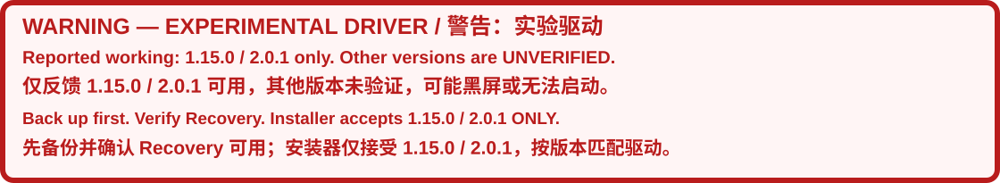

# NVRMFB EDID HiDPI experiment — NullMoth 1.15.0 / 2.0.1



> [!CAUTION]
> **EXPERIMENTAL — MAY CAUSE A BLACK SCREEN OR PREVENT macOS FROM BOOTING.**
> **You MUST carefully read the entire README.md before installation, especially the installation, rollback, offline recovery instructions and precautions.**
> Use only with a working, compatible **NullMoth 1.15.0 or 2.0.1 x86_64** stack. The generic binary has not been hardware-qualified. No particular HiDPI mode is guaranteed.
> **Save this machine’s own NVRMFB + matching AuxKC, verify Recovery boots, and keep an external backup. A USB EFI or Reset NVRAM alone cannot restore system drivers.**

> [!CAUTION]
> **实验版：可能黑屏或无法进入 macOS。**
> **安装前必须认真阅读完整 README.md，尤其是安装方法、回退方法、无法进入系统时的恢复步骤及注意事项。**
> **必须保存该设备自己的 NVRMFB 和配套 AuxKC，确认能进入 Recovery，并保留外部备份。只换 U 盘 EFI、重置 NVRAM，都不能完成系统驱动回退。**

**English · [简体中文](#简体中文)**

**Quick links: [Double-click tools](#double-click-installation-and-rollback) · [Install](#installation) · [Rollback in macOS](#rollback-in-macos) · [Cannot boot: Recovery](#cannot-boot-offline-recovery) · [中文安装](#中文安装) · [无法进入系统](#无法进入系统时离线回退)**

This is an experimental replacement for **NVRMFB only**, built separately from pinned upstream v1.15.0 and v2.0.1 sources. The package contains no private hardware identifiers, account names, SMBIOS identity, EFI, machine-specific AuxKC, or private recovery backup.

## Strict compatibility notice

> [!WARNING]
> **Working compatibility has been reported only for versions 1.15.0 and 2.0.1. All other versions are unverified; do not treat them as supported or bypass version checks.**
> **This package contains separate 1.15.0 and 2.0.1 source-matched builds. Its installer accepts only these exact versions. Both payloads are separately compiled and selected automatically. The 2.0.1 build preserves upstream 2.0.1 framebuffer changes; it is not the older binary relabeled as compatible. Hardware feedback is not independent validation of every package payload.**

Compatibility feedback supplied for three devices; detailed logs and a complete device-by-version test matrix were not supplied. The table does not assert that every device passed both versions.

| Device | Report |
| --- | --- |
| ASUS TXGaming 6 Pro | Reported working; detailed version matrix not supplied |
| Lenovo Legion Y7000P 2023 | Reported working; detailed version matrix not supplied |
| ROG Laptop (exact model not provided) | Reported working; exact model and detailed version matrix not supplied |

**macOS upgrade feedback:** A user reported that HiDPI remained effective after upgrading from **macOS 15.8.1 to macOS 26.7.1**.

## Double-click installation and rollback

> [!IMPORTANT]
> **Keep the entire extracted folder together. Do not copy only a `.command` file. Use either these entry points or the manual procedure below, not both.**
> The helpers have passed simulated file-transaction tests, not an end-to-end installation on other hardware or a real Recovery session. They preserve EFI/boot arguments and never reboot automatically.

| Entry | Run it where | Action |
| --- | --- | --- |
| `Install.command` | Double-click in normal macOS | Verify package; request administrator credentials; create a paired backup; copy it to the chosen external data volume; preflight; replace only NVRMFB; rebuild AuxKC |
| `Rollback.command` | Double-click in normal macOS | Use the last recorded backup path, or a supplied path; check it before restoring NVRMFB and AuxKC together |
| `Recovery.command` | Run with `bash` in Recovery Terminal | Check/mount the target separately, then restore from the paired backup without Python or Perl |

### Automatic UI language and concise output

The `.command` entries automatically use the first macOS preferred language (`AppleLanguages`): any `zh` variant selects Chinese; other languages select English. If unavailable, the shell locale is used, then English. The selected language is passed to privileged helpers and copied with the Recovery tools. UI text is shown in one language at a time; confirmation tokens remain `INSTALL` and `RESTORE`.

Normal installation shows four progress stages instead of per-file checksums and duplicate bilingual paragraphs. Full diagnostic output is retained in the printed `/tmp/nvrmfb-install.…` log. Failures show a short error excerpt. System-tool diagnostics may retain their original language. Boot-failure warnings, backup paths and completion state remain visible.

An optional override is available, especially if Recovery has no saved language preferences:

```sh
NVRMFB_UI_LANG=zh bash "/path/to/extracted-package/Install.command"
NVRMFB_UI_LANG=en bash "/path/to/extracted-package/Install.command"
```

The red, bold warning is a bundled SVG image, so it does not rely on inline CSS in Markdown. Keep `docs/` when sharing; the bold GitHub alert blocks and image alt text provide a text fallback.

**Install:**

1. Read the warnings and verify Recovery can boot and mount/unlock the original data volume. Plug in a writable external **data** volume.
2. Double-click `Install.command` in the extracted folder. Enter the macOS administrator password in Terminal; typed password characters are not displayed.
3. The program prints the newly created private backup directory. Enter the external volume's full path, for example `/Volumes/YOUR-USB`, **without quotes or backslash escapes**. It creates a new backup subdirectory there; the EFI is not overwritten. Leaving this field empty stops after backup, with no driver replacement.
4. Only after the external copy succeeds, type `INSTALL` to proceed. Any other answer cancels before replacing drivers.
5. Wait for `INSTALLED` **and** the final external-backup refresh success. If copying fails after installation, preserve the internal backup and fix the external copy before rebooting.
6. Save work and reboot manually. The first boot should omit `nvfbhidpi=1`. If this argument was already present, remove only it using the active EFI's configuration before rebooting; the installer does not remove it for you. After baseline checks pass, add it again for the experiment.

If executable permissions were lost, run the same entry from Terminal instead of changing system security policy:

```sh
bash "/path/to/extracted-package/Install.command"
```

**Rollback while macOS works:** double-click `Rollback.command`. Press Return to use the printed default backup path, or enter the exact backup directory without quotes. Checks run first. Type `RESTORE` to restore, then remove only the experimental boot argument if added and reboot manually. A cancelled installation may have recorded a newer backup; always review the displayed path.

**Cannot boot:** in OpenCore press Space and enter Recovery; mount/unlock the original data volume in Disk Utility, then open Utilities → Terminal. Set actual paths, not these placeholders:

```sh
NVRMFB_TARGET="/Volumes/YOUR-MACOS-DATA-VOLUME"
NVRMFB_BACKUP="/Volumes/YOUR-USB/HiDPI-backup-EXACT-DIRECTORY-NAME"
bash "$NVRMFB_BACKUP/Recovery.command" --check "$NVRMFB_TARGET"
bash "$NVRMFB_BACKUP/Recovery.command" "$NVRMFB_TARGET"
```

The first command checks only. The second checks again and requires `RESTORE` before writing. The backup contains its own recovery entry and helper, so keep the entire backup directory. Wait for `RESTORED`, then restart manually. If the external copy lacks the post-install `installed-aux.sha256`, use the original backup inside the mounted data volume at `/Library/NullMoth/…` instead; do not skip the check.

If using `Recovery.command` from the original download instead of from a generated backup, explicitly pass both paths:

```sh
bash "/Volumes/YOUR-USB/extracted-package/Recovery.command" "$NVRMFB_TARGET" "$NVRMFB_BACKUP"
```

`Install.command` stores only the most recent backup path in the current account's `~/Library/Application Support/NVRMFB-EDID-HiDPI/last-backup.txt`. Generated backups and that local state are private; do not redistribute them. `scripts/` contains the shared privileged helpers. Never run an old backup against a later macOS or unrelated extension update. The full manual procedure below remains available for review.

## Before installation

- A known-working NullMoth 1.15.0 or 2.0.1 installation is required. Do not mix releases. Only the framebuffer is replaced; NVRM, NVAccel, NVRMAGDC and user-space GPU components must remain compatible.
- The commands below target the upstream system-volume layout: `/Library/Extensions` and `/Library/KernelCollections/AuxiliaryKernelExtensions.kc`. If the existing installation uses another layout, stop and adapt the procedure first.
- Administrator access, `kmutil`, `codesign`, `shasum`, `openssl` and `PlistBuddy` are needed. Strict ad-hoc signature verification does not grant extension approval. These instructions do not change SIP/AMFI policy.
- Confirm Recovery or compatible macOS installation media actually boots and can unlock/mount the data volume. Keep this README offline. If Recovery cannot boot, prepare recovery media before installing.
- Close the upstream updater and every other kext installer. Do not update macOS or other extensions during this test. Old AuxKC backups must not be restored after unrelated updates.
- Keep a backup of the active EFI, but distinguish it from the system-driver backup. Preserve all existing boot arguments, including `-v` if present.
- Run each stage in order. If a command fails, stop; do not reboot into a partially completed installation or skip a failed check. Backups contain private machine metadata: keep them private and never upload them with this package.

## Installation

### 1. Locate and verify the package

Extract the archive. In Terminal, set the path to the actual extracted folder; the following is an example using the current user’s Downloads directory:

```sh
NVRMFB_PACKAGE="$HOME/Downloads/NVRMFB-EDID-HiDPI-Experimental"
cd "$NVRMFB_PACKAGE"
shasum -a 256 -c SHA256SUMS
for bundle in payloads/*/NVRMFB.kext; do codesign --verify --deep --strict "$bundle"; done
```

Every checksum must report `OK`; signature verification must return without an error. This verifies package integrity, not hardware compatibility.

### 2. Create a fresh, paired backup on this machine

The block below creates a private backup without replacing drivers. It records the original framebuffer, original AuxKC, macOS build, data-volume identity and extension hashes. It requires the release marker to be exactly `1.15.0` or `2.0.1`.

```sh
sudo /bin/bash "$NVRMFB_PACKAGE/scripts/prepare-backup.sh" "$NVRMFB_PACKAGE" en
```

Copy the exact `BACKUP_DIRECTORY` printed above into the next variable. **Replace the placeholder; do not guess a directory name.**

```sh
NVRMFB_BACKUP="/Library/NullMoth/HiDPI-backup-REPLACE-WITH-ACTUAL-OUTPUT"
sudo ls "$NVRMFB_BACKUP"
```

Copy the whole backup directory to a mounted external data volume. Replace `YOUR-USB` with the actual volume name; this does not replace its EFI:

```sh
NVRMFB_USB="/Volumes/YOUR-USB"
test -d "$NVRMFB_USB"
sudo ditto "$NVRMFB_BACKUP" "$NVRMFB_USB/$(basename "$NVRMFB_BACKUP")"
```

Keep the original backup path and external volume name written down. Verify the copied files are readable. The external backup must be refreshed after a successful installation, as explained below.

### 3. Preflight, replace only NVRMFB, then rebuild the live AuxKC

Keep `NVRMFB_PACKAGE` and `NVRMFB_BACKUP` set in the same Terminal session. Review the block before running it. It stages all current kexts, substitutes only NVRMFB, fixes root:wheel ownership, builds a temporary AuxKC, checks all four NVIDIA identifiers, verifies the original extension state, then replaces NVRMFB and builds a matching live collection.

A normal failure before publishing the live AuxKC attempts to put the previous framebuffer back. This is not protection against power loss, force-kill or another process changing the system. Logs and previous files are retained in the printed temporary directory.

```sh
sudo /bin/bash "$NVRMFB_PACKAGE/scripts/install-framebuffer.sh" "$NVRMFB_PACKAGE" "$NVRMFB_BACKUP" en
```

Continue only after `INSTALLED` appears. `No variant specified, falling back to release` alone is an informational message; other errors must be investigated.

Refresh the external backup now so that it includes `installed-aux.sha256`, which the offline restore checks against the installed test collection:

```sh
sudo ditto "$NVRMFB_BACKUP" "$NVRMFB_USB/$(basename "$NVRMFB_BACKUP")"
```

### 4. First boot with the experiment disabled

Save work and restart manually. Do **not** add `nvfbhidpi=1` yet. Verify the desktop and previously working devices, especially networking, audio, Bluetooth and input. If this baseline fails, perform the rollback below.

### 5. Enable the metadata experiment

Back up and edit the EFI actually used to boot. In OpenCore’s configuration, append a space and `nvfbhidpi=1` to:

`NVRAM → Add → 7C436110-AB2A-4BBB-A880-FE41995C9F82 → boot-args`

Preserve all other arguments. Do not add the experiment to every backup EFI. Save work and restart manually. The command does not automatically select a scaled mode or install a display override.

### 6. Verify, then select a mode

```sh
nvram boot-args
kmutil showloaded --list-only | awk '/com.nullmoth.NVRMFB/'
system_profiler SPDisplaysDataType
```

Payload UUIDs: **1.15.0: `8BDBFC44-94EA-380E-8159-DFF6D84D3C84`; 2.0.1: `F2050614-502D-3BA4-9DE0-015F43818C44`**. Confirm the boot argument is present and the payload matching the installed release is loaded. In System Settings → Displays, inspect available resolutions; show all resolutions if needed. Select a HiDPI candidate, not a low-resolution duplicate.

A logical 1920×1080 mode backed by 3840×2160 pixels is 2× HiDPI; logical and backing sizes being equal is not. A larger boot logo or new candidates alone do not prove the desktop is using HiDPI. The patch does not inject missing modes or guarantee a particular scaling percentage. Avoid adding unrelated display overrides in the same test.

## Rollback in macOS

> [!IMPORTANT]
> **Full rollback requires restoring NVRMFB and its matching AuxKC together. Removing `nvfbhidpi=1` only disables the experiment; it does not restore the original binary.**

Close all updaters/installers. Use the paired backup from before this installation, with no intervening macOS or extension updates. Set `NVRMFB_BACKUP` to its actual path. The block verifies backup integrity and that other extensions are unchanged, recognizes the original or recorded test AuxKC, then restores the pair. A mismatch aborts the block; do not bypass it.

```sh
sudo /bin/bash "$NVRMFB_PACKAGE/scripts/restore-framebuffer.sh" /System/Volumes/Data "$NVRMFB_BACKUP" restore en
```

After `RESTORED`, remove only `nvfbhidpi=1` from the active EFI if it was added, then save work and restart manually. The original upstream framebuffer ignores the experimental argument. Display overrides installed separately require their own rollback; these commands do not remove them.

## Cannot boot: offline Recovery

> [!WARNING]
> **Do not erase or reinstall the disk as the first recovery step. Mount the original data volume and restore the paired backup offline. The target is the DATA volume, not the sealed System volume or Recovery itself.**

1. Open the OpenCore picker and press **Space** to reveal auxiliary entries, then choose macOS Recovery. If it is unavailable, use previously tested macOS installation/recovery media.
2. In Disk Utility, show all devices. Select and mount the original macOS **data** volume; unlock it with the appropriate account/FileVault credentials if requested. Do not erase it.
3. Open Utilities → Terminal. Recovery Terminal is already root; do not depend on `sudo` or Python being present.
4. Run `ls /Volumes` and `diskutil apfs list` to inspect actual mount names. Never assume disk numbers remain the same after reboot.
5. Set the following paths. **These are placeholders**: replace the data-volume name, the external volume name, and the exact backup-directory name. Keep quotes around paths with spaces.

```sh
NVRMFB_TARGET="/Volumes/YOUR-MACOS-DATA-VOLUME"
NVRMFB_BACKUP="/Volumes/YOUR-USB/HiDPI-backup-EXACT-DIRECTORY-NAME"
ls "$NVRMFB_TARGET/Library/Extensions/NVRMFB.kext/Contents"
ls "$NVRMFB_BACKUP/NVRMFB.kext/Contents" "$NVRMFB_BACKUP/AuxiliaryKernelExtensions.kc"
```

If the external backup was not refreshed after installation, the original internal backup remains available under `$NVRMFB_TARGET/Library/NullMoth/…`; point `NVRMFB_BACKUP` to that exact directory instead. Do not bypass an unrecognized AuxKC check.

6. Run the complete block below. It checks the target VolumeUUID against the backup before writing. It uses OpenSSL for backup verification so Python and Perl are not required. If any check fails, stop and record the error. The final `RESTORED` message is required before continuing.

```sh
bash "$NVRMFB_BACKUP/Recovery.command" "$NVRMFB_TARGET"
```

7. Restart manually after `RESTORED`. If the original bootloader is intact, the restored original driver should no longer execute the experimental code. An old `nvfbhidpi=1` can be removed after booting back into macOS; it is not understood by the unmodified upstream framebuffer. Use the preserved EFI if the active EFI was also damaged.

If Recovery cannot mount/unlock the data volume, or the backup is missing/corrupt, these commands cannot restore it. Preserve the disk and obtain a working recovery environment or a known-good compatible driver installation; do not substitute another machine’s AuxKC.

## Limits and validation

The opt-in policy checks each digital EDID 1.3/1.4 base block. It reads physical size from the first explicitly preferred non-interlaced DTD, falling back to complete base-block centimetre fields. Missing mode dimensions are filled while an existing complete pair is preserved. HiRes flags are added only to already-enumerated even-sized modes with the preferred aspect, at least preferred size, within that framebuffer’s scaler caps and a 16384-pixel per-axis guard.

There is no model/vendor whitelist or fixed physical size. Invalid/unsupported EDID is left unchanged. CTA/DisplayID preferred timing/physical size parsing is not implemented. No timing, allocation, accelerator ABI or other GPU component is changed.

Compilation, strict ad-hoc signature verification, all 466 (1.15.0) / 467 (2.0.1) import comparisons, clean patch application, and ASan/UBSan tests pass. Tests cover multiple synthetic display geometries, malformed EDID, bounds/fallbacks and 100,000 arbitrary inputs. There are 30 existing upstream warnings, with no added warnings. **The generic binary and the manual installation/recovery procedure have not been validated end-to-end on other hardware or inside a real Recovery session.** Do not equate source tests with boot/display compatibility.

## Files and source

The package includes versioned `payloads/…/NVRMFB.kext`, matching `patches/…` source patches, standalone metadata header, test harness, build helper, `build-report.json`, `SHA256SUMS` and retained upstream license/notices. Portable `.command` entry points and shared shell helpers are included; no machine-bound installer state or personal backup is distributed. Backup directories created by the commands are private and must not be uploaded.

Rebuild with Command Line Tools and an SDK containing Kernel.framework headers. Copy the build helper, `patches/` directory and test harness into a fresh directory, then run:

```sh
NVRMFB_SOURCE_VERSION=1.15.0  # or 2.0.1
git clone --depth 1 --branch "v$NVRMFB_SOURCE_VERSION" https://github.com/nullmoth/nvidia-macos-driver.git source
git clone --depth 1 --branch 610.57.04 https://github.com/NVIDIA/open-gpu-kernel-modules.git ogkm
git -C source rev-parse HEAD
git -C ogkm rev-parse HEAD
```

Expected commits: `source`: 1.15.0 `56bc4f9ae3105df052eefd3ea094c782e56853c3`; 2.0.1 `db3716fde712f0542ef7fcec29226b26e99e07dc`; `ogkm`: `e4a5faa2567f28c8eabe0ebb6422b6d0abcf37eb`.

```sh
git -C source apply --check ../patches/"$NVRMFB_SOURCE_VERSION".patch
git -C source apply ../patches/"$NVRMFB_SOURCE_VERSION".patch
bash build_framebuffer.sh "$PWD/out-generic"
clang++ -std=c++17 -fsanitize=address,undefined -fno-omit-frame-pointer test_edid_policy.cpp -o test_edid_policy
./test_edid_policy
```

References: [pinned upstream installer](https://github.com/nullmoth/nvidia-macos-driver/blob/v1.15.0/app/Resources/nullmoth-install.sh), [OpenCore auxiliary picker entries](https://dortania.github.io/docs/release/Configuration.html), [Apple Recovery](https://support.apple.com/en-ie/102518), [EDID field definitions](https://github.com/torvalds/linux/blob/v6.12/include/drm/drm_edid.h). Upstream licensing terms continue to apply.

---

# 简体中文

> [!CAUTION]
> **实验版，可能黑屏或无法进入系统。没有完成其他硬件的实机验证。**
> **安装前必须认真阅读完整 README.md，尤其是安装、回退、离线恢复方法及注意事项。**
> **先备份、先确认 Recovery 可用，再安装。必须保留该设备自己的 NVRMFB 和匹配 AuxKC，并复制到外部存储。不能使用其他电脑的内核集合。**
> **只换 U 盘 EFI、Reset NVRAM、删除实验参数，都不等于完整恢复系统显卡驱动。**

**快速入口：[双击安装与回退](#双击安装与回退推荐入口) · [中文安装](#中文安装) · [还能进系统时回退](#还能进系统时回退) · [无法进入系统时离线回退](#无法进入系统时离线回退)**

这是分别基于 NullMoth **1.15.0 和 2.0.1** 的通用 NVRMFB 实验版，只替换 framebuffer。文档与压缩包不包含私人硬件标识、用户名、三码、私人 EFI、设备专属内核集合或个人回退备份。

## 严格兼容性警告与反馈设备

> [!WARNING]
> **目前仅收到 1.15.0 和 2.0.1 可用的兼容性反馈。其他版本全部未验证，不得当作已支持，也不要绕过版本检查安装。**
> **此包分别从 1.15.0、2.0.1 源码编译两份驱动，安装器只接受这两个精确版本并自动选择配套文件。2.0.1 构建保留上游新版 framebuffer 改动，不使用旧二进制冒充新版。设备反馈不代表每份构建都在所有设备完成独立实测。**

三台设备的兼容性反馈如下。尚未提供完整日志及逐设备、逐版本的测试矩阵，因此不把表格写成“三台设备均在两个版本通过”。

| 设备 | 反馈情况 |
| --- | --- |
| ASUS TXGaming 6 Pro | 反馈可用；未提供完整版本矩阵 |
| Lenovo Legion Y7000P 2023 | 反馈可用；未提供完整版本矩阵 |
| ROG Laptop（具体型号未提供） | 反馈可用；具体型号和完整版本矩阵未提供 |

**macOS 升级反馈：** 有用户报告，从 **macOS 15.8.1 升级到 macOS 26.7.1** 后，HiDPI 仍然生效。

## 双击安装与回退（推荐入口）

> [!IMPORTANT]
> **必须保留整个解压文件夹，不能只复制 `.command` 单文件。双击入口与下方手动流程选一种，不要重复执行。**
> 辅助脚本已通过模拟文件事务测试，尚未完成其他硬件和真实 Recovery 的端到端验证。不会修改 EFI、启动参数，也不会自动重启。

| 文件 | 运行位置 | 用途 |
| --- | --- | --- |
| `Install.command` | 正常 macOS 中双击 | 校验、管理员授权、配对备份、复制外部备份、预检、仅替换 NVRMFB、重建 AuxKC |
| `Rollback.command` | 正常 macOS 中双击 | 核对默认或指定备份，同时恢复 NVRMFB 和配套 AuxKC |
| `Recovery.command` | Recovery 终端中用 `bash` 执行 | 使用备份中的入口离线回退，不依赖 Python/Perl |

### 自动识别语言与精简输出

`.command` 优先读取 macOS 首选语言列表 `AppleLanguages` 的第一项：`zh` 开头使用中文，其他语言使用英文；读取不到时参考终端区域设置，最后回退到英文。语言会传给管理员辅助脚本，并随 Recovery 工具一同复制。界面每次只显示一种语言，确认口令仍为 `INSTALL`、`RESTORE`。

正常安装只显示四个进度阶段，逐文件校验结果和重复的双语段落写入日志。完整日志路径会显示为 `/tmp/nvrmfb-install.…`；失败时显示简短错误摘要。系统工具诊断可能仍保留原语言。风险提示、备份路径和完成状态不会隐藏。

恢复环境没有语言偏好时，可手动指定：

```sh
NVRMFB_UI_LANG=zh bash "/实际解压路径/Install.command"
NVRMFB_UI_LANG=en bash "/实际解压路径/Install.command"
```

顶部红色粗体警告使用包内 SVG 横幅，不依赖 Markdown 中可能被过滤的行内 CSS。分享时请保留 `docs/`；加粗警告框和图片替代文字同时保留，作为纯文本回退。

**安装步骤：**

1. 先读顶部风险提示，确认 Recovery 能启动、挂载并解锁原数据卷，插入可写的外部**数据卷**。
2. 双击完整文件夹中的 `Install.command`，在终端输入 macOS 管理员密码；输入密码时不显示字符。
3. 程序生成内部配对备份并显示路径。输入外部卷完整路径，例如 `/Volumes/YOUR-USB`，**不加引号，不加反斜杠转义**。程序会在其下新建备份目录，不覆盖 EFI。此处留空，只保留备份并结束，不替换驱动。
4. 外部副本核对成功后，输入 `INSTALL` 才继续安装；其他回答会在替换驱动前取消。
5. 等待 `INSTALLED` 以及最后的“外部备份同步完成”提示。若安装后外部同步失败，保留内部备份，先完成外部复制再重启。
6. 保存工作，自行重启。首次基础验证应不含 `nvfbhidpi=1`；若此前已有这个参数，请先用 OCC 从实际启动 EFI 中仅移除它，其他参数保留。安装器不会代替你修改参数。基础验证通过后，再加回该参数做 HiDPI 实验。

如果解压后执行权限丢失，可从终端调用同一入口，无需关闭系统安全策略：

```sh
bash "/实际解压路径/Install.command"
```

**还能进系统：**双击 `Rollback.command`，核对显示的默认备份路径；留空使用默认路径，或输入不带引号的真实备份目录。先检查，输入 `RESTORE` 才恢复；完成后移除本次实验参数并自行重启。曾取消安装时，记录可能指向新建的备份，务必核对所选目录。

**无法进系统：**OpenCore 按空格进入 Recovery，在磁盘工具中挂载、解锁原数据卷，再打开“实用工具 → 终端”。替换下面的占位符：

```sh
NVRMFB_TARGET="/Volumes/原macOS数据卷的真实名称"
NVRMFB_BACKUP="/Volumes/U盘真实名称/HiDPI-backup-真实目录名"
bash "$NVRMFB_BACKUP/Recovery.command" --check "$NVRMFB_TARGET"
bash "$NVRMFB_BACKUP/Recovery.command" "$NVRMFB_TARGET"
```

第一条只检查、不写入；第二条重新检查，并要求输入 `RESTORE` 才恢复。备份里已包含恢复入口和辅助脚本，必须保留整个备份目录。看到 `RESTORED` 后再自行重启。若 U 盘副本缺少安装后生成的 `installed-aux.sha256`，改用已挂载数据卷内部 `/Library/NullMoth/…` 下的原备份，不跳过检查。

如果运行的是原下载包内的恢复入口，而不是备份中的入口，需要同时指定数据卷和备份路径：

```sh
bash "/Volumes/U盘真实名称/解压文件夹/Recovery.command" "$NVRMFB_TARGET" "$NVRMFB_BACKUP"
```

安装器只在当前账户的 `~/Library/Application Support/NVRMFB-EDID-HiDPI/last-backup.txt` 保存最近一次备份路径。现场备份和本地记录均为私有文件，不应公开上传。`scripts/` 为共享的管理员辅助脚本。系统或其他扩展更新后，不要使用旧集合回退；详细手动流程仍保留在下方，供检查和排障。

## 安装前必须确认

- 已有正常工作的 **NullMoth 1.15.0 或 2.0.1 x86_64** 环境；不混用其他版本。NVRM、NVAccel、NVRMAGDC 和用户态组件保持兼容，不同时更新。
- 现有安装使用 `/Library/Extensions` 和 `/Library/KernelCollections/AuxiliaryKernelExtensions.kc`。目录结构不同，不能直接照抄命令。
- 能使用管理员权限，系统中有 `kmutil`、`codesign`、`shasum`、`openssl`、`PlistBuddy`。ad-hoc 签名校验通过不代表系统已经允许加载；命令不修改 SIP/AMFI。
- 实际确认 Recovery 或安装介质能启动，且能挂载、解锁原来的数据卷。无法进入恢复环境，应先准备救援介质。
- 关闭更新器和其他 kext 安装工具。测试期间不更新系统和其他扩展；更新后不能直接恢复旧 AuxKC。
- 保存现用 EFI，但不要把 EFI 备份当成系统驱动备份。保留现有全部启动参数，包括原本存在的 `-v`。
- 命令按阶段执行，任何报错都先停止排查。备份里会现场生成设备卷标识等私有元数据，不得把备份目录上传公开仓库。

## 中文安装

### 1. 解压并校验通用包

在终端设置真实解压路径。下面只是“下载”目录示例，不包含固定用户名：

```sh
NVRMFB_PACKAGE="$HOME/Downloads/NVRMFB-EDID-HiDPI-Experimental"
cd "$NVRMFB_PACKAGE"
shasum -a 256 -c SHA256SUMS
for bundle in payloads/*/NVRMFB.kext; do codesign --verify --deep --strict "$bundle"; done
```

所有校验都应显示 `OK`，签名校验不能报错。完整性校验不代表硬件兼容性已验证。

### 2. 生成该设备自己的完整配对备份

下面只创建备份，不替换驱动。会保存安装前的 NVRMFB、配套 AuxKC、系统构建版本、数据卷身份和扩展校验记录；版本标记必须为 `1.15.0` 或 `2.0.1`：

```sh
sudo /bin/bash "$NVRMFB_PACKAGE/scripts/prepare-backup.sh" "$NVRMFB_PACKAGE" zh
```

将输出的 `BACKUP_DIRECTORY` **原样填入**下面变量，不能保留示例占位符：

```sh
NVRMFB_BACKUP="/Library/NullMoth/HiDPI-backup-REPLACE-WITH-ACTUAL-OUTPUT"
sudo ls "$NVRMFB_BACKUP"
```

将整个备份复制到 U 盘的普通数据区。`YOUR-USB` 替换为实际卷名，不覆盖 U 盘 EFI：

```sh
NVRMFB_USB="/Volumes/YOUR-USB"
test -d "$NVRMFB_USB"
sudo ditto "$NVRMFB_BACKUP" "$NVRMFB_USB/$(basename "$NVRMFB_BACKUP")"
```

记下内部备份完整路径和 U 盘卷名，检查外部副本能读取。安装成功后还需要重新同步一次备份，以包含新集合的校验记录。

### 3. 临时预检、仅替换 NVRMFB、重建系统 AuxKC

在同一个终端会话中保留上述变量，完整执行以下区块。它会暂存全部现用 kext，仅替换暂存 NVRMFB，设置 root:wheel 权限，构建临时 AuxKC 并确认四个 NVIDIA 模块存在，然后核对原扩展状态，再替换系统 NVRMFB 并重建实际使用的集合。

在发布新 AuxKC 前，普通命令报错会尝试恢复原 framebuffer；断电、强制杀进程、其他程序并发改动不受这个回退保证保护。日志与前一个版本会保留在输出的临时目录。

```sh
sudo /bin/bash "$NVRMFB_PACKAGE/scripts/install-framebuffer.sh" "$NVRMFB_PACKAGE" "$NVRMFB_BACKUP" zh
```

只有出现 **`INSTALLED`** 才继续。单独的 `No variant specified, falling back to release` 是提示信息；其他报错必须检查。

安装成功后重新复制备份，使 U 盘副本包含 `installed-aux.sha256`。离线回退用它判断当前集合是否属于本次测试：

```sh
sudo ditto "$NVRMFB_BACKUP" "$NVRMFB_USB/$(basename "$NVRMFB_BACKUP")"
```

### 4. 第一次重启先保持实验关闭

保存工作后自行重启，**先不要添加 `nvfbhidpi=1`**。确认桌面、原有网络、声音、蓝牙、输入设备正常。基础启动失败，就按下面步骤回退，不继续添加实验参数。

### 5. 开启实验参数

备份并编辑实际用于启动的 EFI。在 OCC/OpenCore 配置中找到：

`NVRAM → Add → 7C436110-AB2A-4BBB-A880-FE41995C9F82 → boot-args`

在原参数末尾加一个空格和 **`nvfbhidpi=1`**，其余参数全部保留。不要把所有备用 EFI 也改成实验配置。保存工作后再次手动重启。此步骤不会自动切换缩放，也不会安装显示覆盖文件。

### 6. 确认加载并手动选择 HiDPI

```sh
nvram boot-args
kmutil showloaded --list-only | awk '/com.nullmoth.NVRMFB/'
system_profiler SPDisplaysDataType
```

配套 UUID：**1.15.0 为 `8BDBFC44-94EA-380E-8159-DFF6D84D3C84`；2.0.1 为 `F2050614-502D-3BA4-9DE0-015F43818C44`**。核对参数和实际加载版本，再到“系统设置 → 显示器”查看分辨率，必要时显示全部分辨率。选择 HiDPI 候选，不要误选同名的“低分辨率”模式。

例如逻辑 1920×1080、实际渲染 3840×2160，才是 2 倍 HiDPI。逻辑尺寸与实际像素相同不算。开机 Logo 变大、列表出现候选，也不能直接报告桌面 HiDPI 已成功。缺少所需 backing 模式时，本补丁不会凭空补出模式；测试期间不要叠加其他显示覆盖修改。

## 还能进系统时回退

> [!IMPORTANT]
> **完整回退必须同时恢复安装前的 NVRMFB 和匹配 AuxKC。删除 `nvfbhidpi=1` 只关闭实验逻辑，不会恢复原二进制文件。**

关闭所有更新器和安装工具。确保此后没有更新系统或其他扩展，将 `NVRMFB_BACKUP` 指向本次安装前的真实备份目录，再完整执行以下区块。它会检查备份、其他扩展及当前集合的身份；任何校验失败都先停止，不能绕过。

```sh
sudo /bin/bash "$NVRMFB_PACKAGE/scripts/restore-framebuffer.sh" /System/Volumes/Data "$NVRMFB_BACKUP" restore zh
```

看到 **`RESTORED`** 后，从实际启动 EFI 中仅删除本次添加的 `nvfbhidpi=1`，保存工作，再重启。原版上游驱动不处理该实验参数。单独安装过的显示覆盖文件必须按其自己的备份恢复，这组命令不删除它们。

## 无法进入系统时离线回退

> [!WARNING]
> **先进入 Recovery 恢复驱动，不要先抹盘。目标必须是原 macOS 的“数据卷”，不是只读系统卷，也不是恢复环境本身。**

1. 在 OpenCore 菜单按 **空格** 展开辅助项目，选择 **macOS Recovery**。没有该入口，使用预先验证过的安装/恢复介质。
2. 打开“磁盘工具”，显示所有设备，选中原 macOS 的**数据卷**并挂载。若要求解锁，输入该系统对应账户或 FileVault 凭据。不要抹掉磁盘。
3. 顶部菜单打开“实用工具 → 终端”。Recovery 终端已经是 root，不依赖 `sudo` 或 Python。
4. 用 `ls /Volumes` 和 `diskutil apfs list` 查看实际挂载名称。重启后磁盘编号可能变化，不按旧编号盲猜。
5. 填写下面两个真实路径。**全部占位符都需要替换**；包含空格的路径必须保留引号：

```sh
NVRMFB_TARGET="/Volumes/YOUR-MACOS-DATA-VOLUME"
NVRMFB_BACKUP="/Volumes/YOUR-USB/HiDPI-backup-EXACT-DIRECTORY-NAME"
ls "$NVRMFB_TARGET/Library/Extensions/NVRMFB.kext/Contents"
ls "$NVRMFB_BACKUP/NVRMFB.kext/Contents" "$NVRMFB_BACKUP/AuxiliaryKernelExtensions.kc"
```

如果 U 盘副本没有在安装成功后重新同步，可将 `NVRMFB_BACKUP` 指向数据卷内部的原备份：`$NVRMFB_TARGET/Library/NullMoth/实际备份目录名`，其中应包含安装后记录的集合校验值。不要跳过“当前集合无法识别”的检查。

6. 完整执行以下区块。写入前会核对数据卷 UUID 与备份是否属于同一设备，并使用 OpenSSL 校验原文件，不依赖恢复环境中的 Python/Perl。报错就停止并记录输出；必须看到最终 **`RESTORED`** 才继续：

```sh
bash "$NVRMFB_BACKUP/Recovery.command" "$NVRMFB_TARGET"
```

7. 恢复成功后手动重启。原版上游驱动不会执行实验逻辑；即使 EFI 暂时还留着 `nvfbhidpi=1`，也可先进入系统再删除它。若 EFI 本身也被改坏，使用保留的正常 EFI。

数据卷无法挂载/解锁、备份缺失或损坏时，上述命令无法替代有效的恢复环境和备份。先保留磁盘，准备可用恢复介质或匹配的正常驱动安装，不使用其他机器的 AuxKC。

## 注意事项、实现范围与验证边界

- 基于每个输出各自的数字 EDID 1.3/1.4，不限定品牌、型号、物理尺寸或固定屏幕比例。
- 读取首选非隔行 DTD 的毫米尺寸，没有可用值时回退到完整的厘米尺寸；保留已有完整的物理尺寸。异常或不支持的 EDID 保持原状。
- 只给已枚举、偶数尺寸、不小于首选尺寸、比例与首选模式相同、处于实际 scaler 上限内且每轴不超过 16384 像素的模式添加 HiRes 候选标记。
- 不修改显示时序、显存分配、GPU ABI 或其他驱动。尚未解析 CTA/DisplayID 扩展中的首选模式和尺寸，不能覆盖所有显示器。
- 编译、签名、466（1.15.0）/467（2.0.1）个导入符号比较、补丁应用与 ASan/UBSan 测试通过；覆盖多种合成屏幕参数、异常 EDID、边界和十万组输入。保留 30 条上游原有警告，没有新增警告。
- **通用二进制和上述安装/回退流程尚未在其他硬件与真实 Recovery 中完成端到端验证。** 测试通过不等于实际启动、切换显示模式和设备兼容性已验证。
- 此包提供通用 `.command` 入口与共享 Shell 辅助脚本，不附带绑定特定设备的安装状态；在目标设备现场生成备份。生成的备份包含私有卷信息，**不要公开上传**。
- 包内源码版本、复现编译命令与参考链接见英文部分；保留上游许可和声明，使用与再分发继续受其约束。
